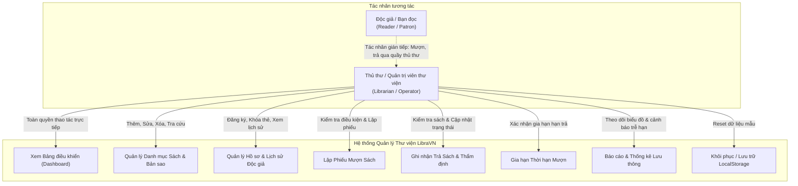
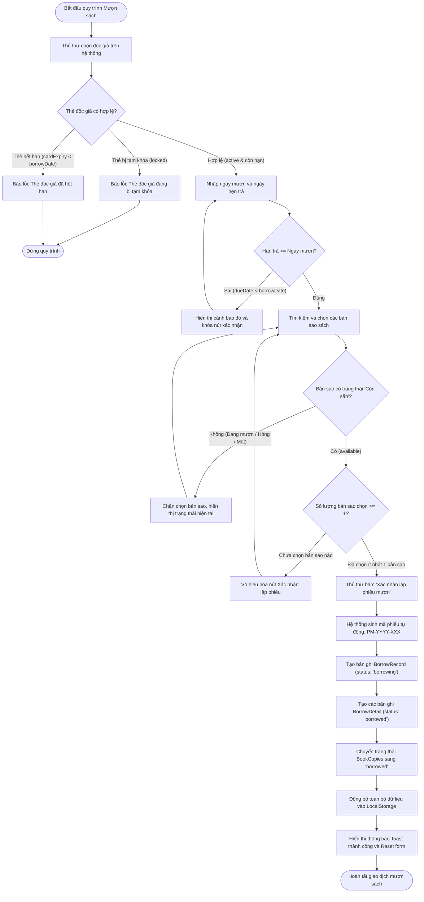
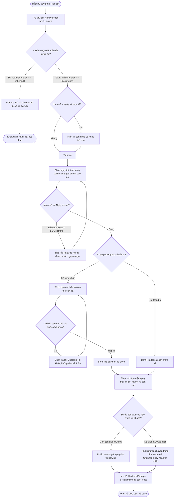
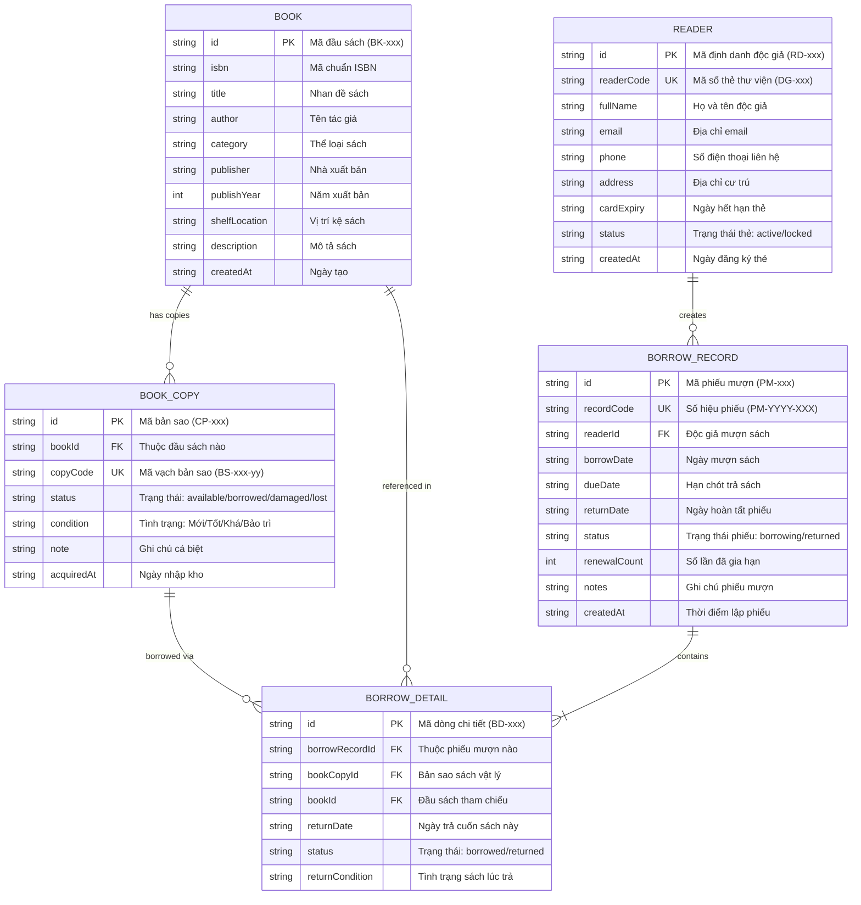

# BÁO CÁO BÀI TẬP THỰC HÀNH — LAB 02
## ĐỀ TÀI: PHÂN TÍCH, THIẾT KẾ VÀ XÂY DỰNG HỆ THỐNG QUẢN LÝ THƯ VIỆN ỨNG DỤNG CÔNG CỤ AI

---

* **Học phần:** Phát triển Ứng dụng & Công nghệ Phần mềm ứng dụng AI
* **Sinh viên thực hiện:** Châu Thị Khánh Linh
* **Mã số sinh viên (MSSV):** 29209257125
* **Tên dự án ứng dụng:** LibraVN — Hệ Thống Quản Lý Thư Viện Hiện Đại
* **Thời gian thực hiện:** Tháng 11/2026
* **Môi trường & Công cụ:** Google AI Studio, Antigravity IDE, React 19, TypeScript 7, Vite 8, Tailwind CSS v4

---

## MỤC LỤC
1. [GIỚI THIỆU HỆ THỐNG](#1-giới-thiệu-hệ-thống)
   - 1.1. Bối cảnh và vấn đề cần giải quyết
   - 1.2. Mục tiêu hệ thống
   - 1.3. Công nghệ và công cụ thực tế sử dụng
2. [PHÂN TÍCH CHỨC NĂNG HỆ THỐNG](#2-phân-tích-chức-năng-hệ-thống)
   - 2.1. Xác định tác nhân sử dụng (Actors)
   - 2.2. Danh mục phân hệ nghiệp vụ
   - 2.3. Bảng phân tích chi tiết các chức năng đã triển khai
   - 2.4. Phân định chức năng đã triển khai và chức năng chưa triển khai
3. [PHÂN TÍCH QUY TRÌNH NGHIỆP VỤ MƯỢN / TRẢ SÁCH](#3-phân-tích-quy-trình-nghiệp-vụ-mượn--trả-sách)
   - 3.1. Quy trình Mượn sách (Borrowing Process)
   - 3.2. Sơ đồ luồng nghiệp vụ Mượn sách (Flowchart)
   - 3.3. Quy trình Trả sách (Returning Process)
   - 3.4. Sơ đồ luồng nghiệp vụ Trả sách (Flowchart)
   - 3.5. Quy trình Gia hạn sách (Renewal Process)
4. [THIẾT KẾ CẤU TRÚC DỮ LIỆU](#4-thiết-kế-cấu-trúc-dữ-liệu)
   - 4.1. Nền tảng và kiến trúc lưu trữ dữ liệu thực tế
   - 4.2. Từ điển dữ liệu chi tiết (Data Dictionary)
   - 4.3. Quan hệ giữa các thực thể dữ liệu
   - 4.4. Sơ đồ thực thể liên kết (ERD)
5. [QUY TRÌNH TRIỂN KHAI BẰNG CÔNG CỤ AI](#5-quy-trình-triển-khai-bằng-công-cụ-ai)
   - 5.1. Quy trình tạo mẫu ban đầu bằng Google AI Studio
   - 5.2. Quy trình phân tích, tối ưu và kiểm thử trong Antigravity IDE
   - 5.3. Vị trí chèn ảnh minh chứng thực tế
6. [KIỂM THỬ VÀ ĐÁNH GIÁ CHẤT LƯỢNG](#6-kiểm-thử-và-đánh-giá-chất-lượng)
   - 6.1. Phương pháp và kết quả kiểm thử tự động
   - 6.2. Ma trận kiểm thử các quy tắc nghiệp vụ cốt lõi
   - 6.3. Đánh giá hạn chế của ứng dụng
7. [KẾT LUẬN VÀ HƯỚNG PHÁT TRIỂN](#7-kết-luận-và-hướng-phát-triển)
   - 7.1. Tóm tắt kết quả đạt được
   - 7.2. Đề xuất hướng phát triển mở rộng

---

## 1. GIỚI THIỆU HỆ THỐNG

### 1.1. Bối cảnh và vấn đề cần giải quyết
Trong kỷ nguyên số hóa giáo dục và nghiên cứu, công tác quản lý tài nguyên thư viện đóng vai trò then chốt tại các trường đại học, cao đẳng và viện nghiên cứu. Tuy nhiên, phương thức quản trị thư viện truyền thống bằng sổ tay hoặc các bảng tính rời rạc (Excel) bộc lộ nhiều điểm nghẽn nghiêm trọng:
- **Khó khăn trong quản lý bản sao vật lý:** Một đầu sách thường có nhiều bản sao với tình trạng vật lý (mới, tốt, rách hỏng, bảo trì) và trạng thái lưu thông khác nhau. Quản lý thủ công dễ gây nhầm lẫn giữa bản sao còn sẵn trên kệ và bản sao đang được độc giả mượn.
- **Thất thoát sách và quá hạn lưu thông:** Thiếu cơ chế theo dõi tự động thời hạn mượn, dẫn đến tỷ lệ sách trễ hạn cao mà thủ thư không kịp thời phát hiện để nhắc nhở hoặc áp dụng chế tài.
- **Dữ liệu phân tán và chậm cập nhật:** Việc lập báo cáo thống kê lượt mượn/trả, đầu sách mượn nhiều nhất thường tốn nhiều ngày công và thiếu tính chính xác theo thời gian thực.
- **Rào cản về hạ tầng kỹ thuật:** Các phần mềm thư viện thương mại phức tạp thường đòi hỏi máy chủ cơ sở dữ liệu chuyên dụng (SQL Server, Oracle), chi phí bản quyền đắt đỏ và cấu hình triển khai cồng kềnh, không phù hợp cho các thư viện quy mô vừa hoặc phòng tư liệu chuyên ngành.

Hệ thống **LibraVN** ra đời nhằm giải quyết triệt để các vấn đề trên thông qua việc cung cấp một nền tảng Web quản lý lưu thông trực quan, vận hành độc lập trực tiếp trên trình duyệt, không phụ thuộc máy chủ backend và đảm bảo tính toàn vẹn nghiệp vụ thư viện tiêu chuẩn.

### 1.2. Mục tiêu hệ thống
- **Số hóa toàn diện dữ liệu danh mục sách và bản sao vật lý:** Quản lý chi tiết từng đầu sách theo chuẩn ISBN, phân loại thể loại, vị trí giá kệ và quản trị mã định danh từng cuốn sách cụ thể (`BookCopy`).
- **Quản lý vòng đời thẻ độc giả:** Lưu trữ hồ sơ độc giả, kiểm soát hạn sử dụng thẻ, trạng thái hoạt động (kích hoạt/tạm khóa) và truy vết toàn bộ lịch sử lưu thông.
- **Tự động hóa chu trình mượn — trả — gia hạn:** Đảm bảo thực thi nghiêm ngặt các quy tắc nghiệp vụ (chặn mượn sách đã mượn, chặn trả 2 lần, chặn xóa độc giả đang nợ sách, chặn hạn trả trước ngày mượn).
- **Trực quan hóa chỉ số vận hành (Dashboard & Analytics):** Cung cấp các biểu đồ SVG tương tác thời gian thực, bảng xếp hạng đầu sách được quan tâm nhất và danh sách cảnh báo quá hạn trực quan.
- **Đảm bảo tính bền vững dữ liệu:** Lưu trữ cục bộ an toàn trên Web LocalStorage API, tự động đồng bộ sau mỗi giao dịch và hỗ trợ khôi phục dữ liệu mẫu chuẩn khi cần.

### 1.3. Công nghệ và công cụ thực tế sử dụng
Mã nguồn dự án phản ánh cấu trúc công nghệ hiện đại, nhẹ nhàng và tối ưu hóa hiệu năng cao:

| Thành phần | Công nghệ / Thư viện thực tế | Phiên bản | Mục đích sử dụng trong dự án |
| :--- | :--- | :---: | :--- |
| **Môi trường phát triển AI** | **Google AI Studio** | — | Sinh mã khởi tạo khung dự án ban đầu từ prompt ngôn ngữ tự nhiên. |
| **IDE & Môi trường Agentic** | **Antigravity IDE** | v2.0 | Nền tảng lập trình hỗ trợ AI Agent, kiểm thử tự động, gỡ lỗi và refactoring mã nguồn. |
| **Nền tảng thực thi** | **Node.js** | v24.22.0 | Môi trường chạy công cụ phát triển, kiểm thử và biên dịch. |
| **Ngôn ngữ lập trình** | **TypeScript** | v7.0.2 / Strict | Đảm bảo an toàn kiểu dữ liệu tĩnh (`strict: true`), ngăn ngừa lỗi runtime. |
| **Thư viện giao diện** | **React** | v19.0.1 | Kiến trúc Single Page Application (SPA), sử dụng Functional Components & Hooks hiện đại. |
| **Công cụ đóng gói (Bundler)**| **Vite** | v8.3.8 | Môi trường dev siêu tốc và biên dịch production tối ưu bằng ES Modules (`@vitejs/plugin-react`). |
| **Framework định dạng CSS** | **Tailwind CSS** | v4.3.3 | Thiết kế giao diện phẳng (Utility-first), tông màu chủ đạo Blue & Slate hiện đại, responsive. |
| **Bộ biểu tượng (Iconography)**| **Lucide React** | v0.546.0 | Hệ thống icon chuẩn mực (BookOpen, Users, Undo2, CalendarClock, AlertCircle,...). |
| **Cơ chế lưu trữ dữ liệu** | **Web LocalStorage API** | Web API | Lưu trữ bền vững dữ liệu JSON trực tiếp trên trình duyệt người dùng qua module `storage.ts`. |
| **Công cụ kiểm thử tự động** | **TSX Runner (`tsx`)** | v4.23.15 | Thực thi trực tiếp các kịch bản kiểm thử TypeScript mà không cần cấu hình build trung gian. |

---

## 2. PHÂN TÍCH CHỨC NĂNG HỆ THỐNG

### 2.1. Xác định tác nhân sử dụng (Actors)
Trong phạm vi kiến trúc hiện tại của dự án LibraVN, tác nhân sử dụng hệ thống được phân định rõ ràng như sau:

* **Thủ thư (Librarian - Tác nhân trực tiếp):** Là người vận hành toàn bộ phần mềm tại quầy lưu thông và phòng quản trị sách. Có quyền truy cập đầy đủ vào tất cả các phân hệ của ứng dụng.
* **Độc giả (Reader - Tác nhân gián tiếp):** Trong phiên bản hiện tại, độc giả tương tác thông qua thủ thư (xuất trình thẻ độc giả và sách cần mượn/trả). Hệ thống lưu giữ định danh, liên hệ và lịch sử của độc giả mà chưa cung cấp giao diện tự phục vụ riêng biệt.

### 2.2. Danh mục phân hệ nghiệp vụ
Hệ thống được cấu trúc thành 7 phân hệ giao diện chính (tương ứng với `PageKey` trong `src/types/library.ts`):
1. **Phân hệ Tổng quan (Dashboard):** Trung tâm giám sát tức thời các chỉ số KPI, biểu đồ lưu thông hàng tháng và danh sách cảnh báo cần xử lý khẩn cấp.
2. **Phân hệ Quản lý Sách (Books & Book Copies):** Quản lý metadata đầu sách và danh mục bản sao vật lý độc lập.
3. **Phân hệ Quản lý Độc giả (Readers):** Quản lý hồ sơ bạn đọc, trạng thái thẻ và xem chi tiết hồ sơ lưu thông.
4. **Phân hệ Mượn sách (Borrow):** Quy trình tạo giao dịch mượn sách, xác thực điều kiện thẻ và bản sao.
5. **Phân hệ Trả sách (Return):** Tiếp nhận sách hoàn trả, đánh giá tình trạng sách vật lý, hỗ trợ trả từng phần hoặc trả toàn bộ.
6. **Phân hệ Gia hạn sách (Renew):** Xử lý gia hạn thời hạn mượn cho các phiếu chưa hoàn tất với ràng buộc ngày hợp lệ.
7. **Phân hệ Thống kê & Báo cáo (Statistics):** Báo cáo xu hướng mượn theo chu kỳ 6/12 tháng, xếp hạng sách mượn nhiều nhất và danh sách độc giả nợ sách quá hạn.

### 2.3. Bảng phân tích chi tiết các chức năng đã triển khai

| Mã CN | Tên chức năng | Phân hệ | Mô tả nghiệp vụ chi tiết | Dữ liệu đầu vào (Input) | Kết quả đầu ra (Output) |
| :---: | :--- | :--- | :--- | :--- | :--- |
| **FN-DB-01** | Xem chỉ số tổng quan (KPI Cards) | Dashboard | Hiển thị tức thời 6 chỉ số: Tổng đầu sách, Tổng bản sao, Bản sao còn sẵn, Bản sao đang mượn, Tổng độc giả, Phiếu quá hạn. | Dữ liệu `books`, `bookCopies`, `readers`, `borrowRecords`. | 6 thẻ thông số với tỷ lệ phần trăm và cảnh báo màu sắc. |
| **FN-DB-02** | Xem biểu đồ lưu thông hàng tháng | Dashboard | Vẽ biểu đồ cột SVG biểu diễn số phiếu mượn và số bản sao mượn trong 6 tháng gần nhất, có dải hover chi tiết. | Danh sách `borrowRecords`, `borrowDetails`. | Biểu đồ trực quan và dải tóm tắt dữ liệu tháng tương tác. |
| **FN-DB-03** | Theo dõi phiếu mượn gần đây | Dashboard | Liệt kê danh sách các phiếu mượn mới nhất kèm trạng thái (Đang mượn, Đã hoàn tất, Quá hạn). | Dữ liệu `borrowRecords`, sắp xếp giảm dần theo `borrowDate`. | Bảng 6 giao dịch gần nhất, có liên kết điều hướng sang Trả sách. |
| **FN-BK-01** | Thêm đầu sách mới | Quản lý sách | Thêm thông tin đầu sách và tự động tạo số lượng bản sao vật lý ban đầu (từ 0 đến 50 bản sao). | Tên sách, tác giả, thể loại, ISBN, NXB, năm XB, vị trí kệ, mô tả, số bản sao ban đầu. | Bản ghi `Book` mới và danh sách bản ghi `BookCopy` tương ứng, lưu vào LocalStorage. |
| **FN-BK-02** | Chỉnh sửa đầu sách | Quản lý sách | Cập nhật thông tin chi tiết của đầu sách hiện có mà không làm ảnh hưởng đến mã bản sao. | `bookId`, các trường thông tin cập nhật (title, author, category, shelfLocation,...). | Bản ghi `Book` cập nhật; thông báo thành công. |
| **FN-BK-03** | Xóa đầu sách | Quản lý sách | Xóa đầu sách và toàn bộ bản sao liên quan sau khi xác nhận qua hộp thoại ConfirmModal. | `bookId`. Hệ thống kiểm tra ràng buộc không có bản sao nào đang ở trạng thái `borrowed`. | Xóa đầu sách và bản sao khỏi hệ thống hoặc báo lỗi nếu sách đang được mượn. |
| **FN-BK-04** | Tìm kiếm & Lọc sách | Quản lý sách | Tìm kiếm đa tiêu chí theo tên sách, tác giả, ISBN, vị trí kệ; lọc theo thể loại và trạng thái sẵn có. | Từ khóa tìm kiếm `search`, thể loại `category`, trạng thái `availabilityFilter`. | Danh sách đầu sách phù hợp hiển thị tức thì trên bảng. |
| **FN-CP-01** | Quản lý bản sao vật lý | Quản lý sách | Mở modal quản lý danh sách từng bản sao cụ thể của một đầu sách, hiển thị mã bản sao, trạng thái, tình trạng và ngày nhập. | `bookId`. | Danh sách bảng bản sao chi tiết (`BookCopies`). |
| **FN-CP-02** | Thêm bản sao lẻ | Quản lý sách | Thêm một bản sao mới cho đầu sách với mã tự gợi ý `BS-xxx-yy`, chọn tình trạng vật lý ban đầu. | `bookId`, `copyCode`, `condition`, `status`, `note`. | Bản sao mới thêm vào `bookCopies` ở trạng thái `available` hoặc bảo trì. |
| **FN-CP-03** | Chỉnh sửa bản sao lẻ | Quản lý sách | Cho phép sửa trực tiếp (inline edit) mã bản sao, tình trạng và ghi chú. Chặn tự ý đổi sang `borrowed`. | `copyId`, thông tin chỉnh sửa. | Bản sao cập nhật thành công; thông báo Toast. |
| **FN-CP-04** | Xóa bản sao lẻ | Quản lý sách | Xóa một bản sao khỏi đầu sách với điều kiện bản sao không đang thuộc phiếu mượn chưa trả. | `copyId`. | Bản sao bị xóa khỏi danh sách; chặn nếu bản sao đang mượn. |
| **FN-RD-01** | Đăng ký độc giả mới | Quản lý độc giả | Thêm thẻ độc giả mới, tự động sinh mã thẻ `DG-xxx` duy nhất nối tiếp, hạn thẻ mặc định +365 ngày. | Mã thẻ (tự sinh/nhập), họ tên, SĐT, email, địa chỉ, hạn thẻ, trạng thái thẻ. | Bản ghi `Reader` mới lưu vào hệ thống. |
| **FN-RD-02** | Cập nhật thông tin độc giả | Quản lý độc giả | Chỉnh sửa thông tin cá nhân và thay đổi trạng thái thẻ (Đang hoạt động / Tạm khóa). | `readerId`, thông tin cập nhật. | Cập nhật hồ sơ độc giả thành công. |
| **FN-RD-03** | Xóa độc giả | Quản lý độc giả | Xóa thẻ độc giả sau khi xác nhận. Kiểm tra nghiêm ngặt không có phiếu mượn nào chưa hoàn tất. | `readerId`. | Xóa hồ sơ độc giả nếu không nợ sách; báo lỗi nếu còn phiếu chưa hoàn tất. |
| **FN-RD-04** | Xem lịch sử mượn trả | Quản lý độc giả | Xem toàn bộ các phiếu mượn trong quá khứ và hiện tại của độc giả kèm chi tiết từng cuốn sách và ngày trả. | `readerId`. | Modal lịch sử lưu thông với đầy đủ chi tiết từng giao dịch. |
| **FN-BR-01** | Lập phiếu mượn sách | Mượn sách | Tạo phiếu mượn mới cho độc giả đang hoạt động, chọn một hoặc nhiều bản sao còn sẵn, thiết lập hạn trả. | `readerId`, danh sách `copyIds`, ngày mượn `borrowDate`, hạn trả `dueDate`, ghi chú. | Bản ghi `BorrowRecord` (trạng thái `borrowing`), các bản ghi `BorrowDetail`, cập nhật trạng thái bản sao thành `borrowed`. |
| **FN-BR-02** | Chọn nhanh hạn trả | Mượn sách | Các nút preset nhanh +7 ngày, +14 ngày, +30 ngày tính từ ngày mượn. | Số ngày cộng thêm (7, 14, 30). | Tự động tính toán và điền trường `dueDate` chuẩn xác. |
| **FN-RT-01** | Tra cứu phiếu mượn trả | Trả sách | Tìm kiếm phiếu mượn theo mã phiếu, tên độc giả, mã thẻ, tên sách hoặc mã bản sao; lọc theo trạng thái. | Từ khóa tìm kiếm, bộ lọc trạng thái (Đang mượn, Quá hạn, Đã hoàn tất, Tất cả). | Danh sách phiếu mượn phù hợp ở cột Master bên trái. |
| **FN-RT-02** | Ghi nhận trả từng phần | Trả sách | Cho phép tích chọn một số bản sao trong phiếu để trả trước, cập nhật tình trạng sách khi trả. | `recordId`, danh sách `detailIds` được chọn, `returnDate`, `returnCondition`, `copyFinalStatus`. | Cập nhật chi tiết tương ứng thành `returned`, bản sao trở về trạng thái chỉ định, phiếu mượn vẫn giữ `borrowing`. |
| **FN-RT-03** | Ghi nhận trả toàn bộ | Trả sách | Trả tất cả các bản sao còn lại trong phiếu mượn chỉ với một thao tác bấm nút. | `recordId`, ngày trả, tình trạng sách, trạng thái bản sao. | Tất cả chi tiết thành `returned`, phiếu chuyển sang `returned`, cập nhật ngày hoàn tất. |
| **FN-RN-01** | Gia hạn thời hạn phiếu | Gia hạn sách | Gia hạn thêm ngày cho phiếu đang mượn, tự động tăng bộ đếm số lần gia hạn. Chặn phiếu đã hoàn tất. | `recordId`, `newDueDate` (phải > dueDate cũ và >= ngày mượn), lý do gia hạn. | `BorrowRecord` cập nhật `dueDate` mới, `renewalCount` tăng 1. |
| **FN-ST-01** | Thống kê mượn theo chu kỳ | Thống kê | Biểu đồ cột so sánh số phiếu mượn và số bản sao mượn theo chu kỳ 6 tháng hoặc 12 tháng gần nhất kèm bảng chi tiết. | Chọn chu kỳ (6 tháng / 12 tháng). | Biểu đồ SVG và bảng tổng hợp số liệu lưu thông chi tiết từng tháng. |
| **FN-ST-02** | Xếp hạng sách mượn nhiều | Thống kê | Xếp hạng các đầu sách có lượt mượn bản sao nhiều nhất từ cao xuống thấp kèm thanh tỷ lệ trực quan. | Dữ liệu `borrowDetails` tổng hợp theo `bookId`. | Bảng Top 10 sách kèm số lượt mượn và tỷ lệ bản sao còn sẵn/tổng bản. |
| **FN-ST-03** | Danh sách phiếu quá hạn | Thống kê | Tổng hợp tất cả các phiếu chưa hoàn tất có hạn trả trước ngày hiện tại, tính chính xác số ngày quá hạn. | `borrowRecords` có `status === 'borrowing'` và `dueDate < today`. | Bảng cảnh báo quá hạn kèm thông tin liên hệ độc giả và nút điều hướng nhanh sang Trả/Gia hạn. |
| **FN-SY-01** | Khôi phục dữ liệu mẫu | Hệ thống | Khôi phục toàn bộ kho dữ liệu về 16 đầu sách, 34 bản sao, 12 độc giả, 17 phiếu mượn ban đầu sau hộp thoại xác nhận. | Thao tác người dùng xác nhận trên modal `ConfirmModal`. | Làm mới toàn bộ 5 key trong LocalStorage về Seed Data chuẩn; Toast thông báo. |

### 2.4. Phân định chức năng đã triển khai và chức năng chưa triển khai

#### A. Các chức năng ĐÃ TRIỂN KHAI HOÀN CHỈNH (Implemented)
- [x] Quản lý đầu sách đầy đủ (Thêm, Sửa, Xóa có kiểm tra ràng buộc mượn, Tìm kiếm, Lọc theo thể loại và độ sẵn có).
- [x] Quản lý bản sao vật lý độc lập (Thêm tự động theo lô, thêm lẻ, sửa tình trạng vật lý, xóa bản sao an toàn).
- [x] Quản lý thẻ độc giả (Đăng ký, sửa, xóa an toàn, khóa thẻ, lịch sử mượn trả chi tiết).
- [x] Nghiệp vụ Mượn sách (Chọn độc giả hoạt động, chọn bản sao sẵn, chọn nhanh hạn trả, cảnh báo ngày không hợp lệ, tạo phiếu mượn và chi tiết mượn đồng thời).
- [x] Nghiệp vụ Trả sách (Tìm kiếm đa tiêu chí, trả từng phần, trả toàn phần, ghi nhận tình trạng sách khi trả, cập nhật bản sao hỏng/mất, cảnh báo trễ hạn).
- [x] Nghiệp vụ Gia hạn sách (Gia hạn hạn trả, tăng bộ đếm gia hạn, chặn gia hạn phiếu đã hoàn tất).
- [x] Bảng điều khiển Dashboard và Thống kê trực quan (6 thẻ KPI, biểu đồ SVG 6/12 tháng, xếp hạng Top sách, danh sách quá hạn).
- [x] Cơ chế lưu trữ bền vững LocalStorage với khôi phục dữ liệu mẫu (Reset Data).

#### B. Các chức năng CHƯA TRIỂN KHAI / ĐỀ XUẤT MỞ RỘNG (Not Implemented)
- [ ] **Xác thực & Phân quyền người dùng (Authentication & RBAC):** Hiện tại hệ thống hoạt động ở chế độ đơn phiên làm việc (Single-session), chưa có màn hình Đăng nhập/Đăng xuất và chưa phân chia vai trò (Admin, Thủ thư, Độc giả).
- [ ] **Quét mã vạch / Mã QR (Barcode & QR Scanner):** Hiện tại thủ thư nhập hoặc chọn mã sách/thẻ từ giao diện, chưa tích hợp Camera Web API hoặc đầu đọc mã vạch vật lý.
- [ ] **Cổng tra cứu trực tuyến dành cho bạn đọc (OPAC — Online Public Access Catalog):** Cho phép bạn đọc tự tìm kiếm sách, xem vị trí kệ và đặt giữ chỗ (reserve) sách trực tuyến từ xa.
- [ ] **Tính toán và thu tiền phạt quá hạn / đền bù sách mất:** Hệ thống hiện chỉ tính và hiển thị số ngày quá hạn để thủ thư nhắc nhở, chưa có module tính biểu phí phạt (ví dụ: 5.000 VNĐ/ngày trễ) và in biên lai thu tiền.
- [ ] **Đồng bộ hóa đám mây đa máy trạm (Cloud Database Synchronization):** Dữ liệu hiện lưu cục bộ trong LocalStorage của một trình duyệt, chưa đồng bộ hóa qua mạng LAN hoặc Cloud API để nhiều thủ thư cùng làm việc đồng thời.
- [ ] **Xuất báo cáo định dạng file Excel / PDF:** Hiện tại người dùng chỉ xem báo cáo trực tiếp trên giao diện Web, chưa có nút xuất dữ liệu ra file `.xlsx` hoặc `.pdf`.

---

## 3. PHÂN TÍCH QUY TRÌNH NGHIỆP VỤ MƯỢN / TRẢ SÁCH

### 3.1. Quy trình Mượn sách (Borrowing Process)
Quy trình mượn sách được thiết kế chặt chẽ nhằm bảo vệ tài sản thư viện và đảm bảo tính minh bạch trong lưu thông:

1. **Bước 1 — Tiếp nhận yêu cầu:** Độc giả xuất trình thẻ thư viện và mang các bản sao sách cần mượn đến quầy lưu thông.
2. **Bước 2 — Xác định độc giả:** Thủ thư chọn độc giả trên giao diện `BorrowPage`. Hệ thống tự động kiểm tra:
   - *Kiểm tra trạng thái thẻ:* Nếu thẻ bị khóa (`status === 'locked'`), hệ thống từ chối lập phiếu với thông báo `Thẻ của độc giả đang bị tạm khóa`.
   - *Kiểm tra hạn sử dụng thẻ:* Nếu thẻ hết hạn so với ngày mượn (`cardExpiry < borrowDate`), hệ thống từ chối và hiện banner cảnh báo đỏ.
3. **Bước 3 — Thiết lập thời hạn mượn:** Thủ thư xác nhận ngày mượn (`borrowDate`, mặc định là ngày hôm nay) và ngày hẹn trả (`dueDate`).
   - *Kiểm tra quy tắc ngày:* Nếu `dueDate < borrowDate`, hệ thống hiển thị cảnh báo lỗi và vô hiệu hóa nút lập phiếu.
   - Hỗ trợ các nút chọn nhanh thời hạn: `+7 ngày`, `+14 ngày`, `+30 ngày`.
4. **Bước 4 — Chọn bản sao sách:** Thủ thư tìm kiếm và tích chọn các bản sao sách.
   - *Kiểm tra tình trạng bản sao:* Chỉ các bản sao có trạng thái `Còn sẵn` (`status === 'available'`) mới được phép chọn. Các bản sao `Đang mượn`, `Hư hỏng`, `Đã mất` bị khóa nút chọn.
   - Hệ thống cho phép chọn mượn một hoặc nhiều cuốn cùng lúc. Danh sách dự kiến được cập nhật theo thời gian thực ở panel bên phải.
5. **Bước 5 — Xác nhận và Ghi nhận giao dịch:**
   - Hệ thống sinh mã phiếu mượn duy nhất theo quy tắc `PM-YYYY-XXX` (ví dụ: `PM-2026-018`).
   - Tạo mới bản ghi phiếu mượn tổng `BorrowRecord` (trạng thái `borrowing`, `renewalCount: 0`).
   - Tạo danh sách các chi tiết mượn `BorrowDetail` tương ứng với từng bản sao (trạng thái `borrowed`).
   - Cập nhật trạng thái của tất cả các bản sao được chọn trong `BookCopies` sang `borrowed`.
   - Lưu trữ dữ liệu vào `localStorage`.
   - Hiển thị Toast thông báo thành công và xóa sạch lựa chọn trên form để sẵn sàng cho giao dịch tiếp theo.

### 3.2. Sơ đồ luồng nghiệp vụ Mượn sách (Flowchart)

### 3.3. Quy trình Trả sách (Returning Process)
Quy trình trả sách cho phép quản lý linh hoạt việc trả một phần hoặc toàn bộ số sách trong phiếu, đồng thời thẩm định tình trạng vật lý của sách khi nhận lại:

1. **Bước 1 — Tìm kiếm và chọn phiếu mượn:** Thủ thư nhập từ khóa (mã phiếu, tên độc giả, tên sách, mã bản sao) để định vị phiếu mượn trên `ReturnPage`.
2. **Bước 2 — Hiển thị chi tiết và Thẩm định quá hạn:** Hệ thống nạp danh sách bản sao trong phiếu.
   - Nếu phiếu đã hoàn tất (`status === 'returned'`): Hiển thị thông báo phiếu đã trả đủ, khóa các nút thao tác trả sách.
   - Nếu phiếu đang mượn nhưng quá hạn (`dueDate < today`): Hiển thị Banner cảnh báo số ngày quá hạn màu đỏ (nhưng vẫn cho phép tiến hành trả sách để giải phóng tài liệu).
3. **Bước 3 — Thiết lập thông số trả sách:**
   - Nhập ngày trả thực tế (`returnDate`, mặc định là ngày hôm nay). Nếu `returnDate < borrowDate`, hệ thống chặn thao tác.
   - Chọn tình trạng sách khi trả (`returnCondition`: Mới, Tốt, Khá, Cần bảo trì).
   - Chọn trạng thái phân loại sau khi trả (`copyFinalStatus`):
     + *Còn sẵn (available):* Sách còn nguyên vẹn, đưa về giá sách để phục vụ lượt mượn tiếp theo.
     + *Hư hỏng (damaged):* Sách bị rách nát, viết bẩn, chuyển sang trạng thái chờ sửa chữa bảo trì.
     + *Đã mất (lost):* Độc giả làm mất sách, ghi nhận mất để xử lý bồi thường.
4. **Bước 4 — Thực hiện trả sách (Hỗ trợ 2 phương thức):**
   - *Phương thức A — Trả từng phần (Partial Return):* Thủ thư tích chọn một số bản sao chưa trả -> bấm nút `Trả các bản đã chọn (n)`. Các bản sao đã trả trước đó bị khóa checkbox để ngăn trả hai lần (`TC-BR-03`).
   - *Phương thức B — Trả toàn bộ (Full Return):* Bấm nút `Trả tất cả sách chưa trả (m)` để hoàn tất nhanh toàn bộ số sách còn lại.
5. **Bước 5 — Cập nhật dữ liệu hệ thống:**
   - Cập nhật các bản ghi `BorrowDetail` tương ứng: chuyển `status: 'returned'`, gán `returnDate` và `returnCondition`.
   - Cập nhật các bản ghi `BookCopy` tương ứng: chuyển `status` sang `copyFinalStatus` đã chọn và cập nhật tình trạng vật lý mới.
   - *Kiểm tra tính hoàn tất của phiếu:*
     + Nếu vẫn còn bản sao trong phiếu chưa trả: Giữ nguyên trạng thái phiếu `status: 'borrowing'`, `returnDate: null`.
     + Nếu tất cả bản sao trong phiếu đã được trả đầy đủ: Chuyển trạng thái phiếu sang `status: 'returned'`, gán `returnDate: returnDate`.
   - Lưu trữ dữ liệu vào `localStorage`.
   - Cập nhật số liệu trên Dashboard ngay tức thì và thông báo Toast thành công.

### 3.4. Sơ đồ luồng nghiệp vụ Trả sách (Flowchart)

### 3.5. Quy trình Gia hạn sách (Renewal Process)
Quy trình gia hạn được phân tách độc lập tại `RenewPage` nhằm phục vụ độc giả có nhu cầu tiếp tục mượn sách khi chưa đọc xong:
- **Điều kiện tiên quyết:** Phiếu mượn phải ở trạng thái đang mở (`status === 'borrowing'`). Các phiếu đã hoàn tất trả sách tuyệt đối không thể gia hạn (`TC-BR-06`).
- **Ràng buộc thời gian:** Hạn trả mới (`newDueDate`) bắt buộc phải **sau hạn trả hiện tại** và không được trước ngày mượn.
- **Xử lý hệ thống:** Khi thủ thư xác nhận, hệ thống cập nhật trường `dueDate` mới, tự động tăng trường bộ đếm số lần gia hạn `renewalCount = renewalCount + 1`, và lưu lại ghi chú gia hạn vào lịch sử phiếu.

---

## 4. THIẾT KẾ CẤU TRÚC DỮ LIỆU

### 4.1. Nền tảng và kiến trúc lưu trữ dữ liệu thực tế
Căn cứ trực tiếp từ mã nguồn module [src/utils/storage.ts](file:///c:/Users/LENOVO/Downloads/Lab_QLThuVien_29209257125_ChauThiKhanhLinh/src/utils/storage.ts), hệ thống **LibraVN không sử dụng cơ sở dữ liệu quan hệ truyền thống (RDBMS như SQL Server, MySQL, PostgreSQL) và cũng không kết nối Backend API từ xa**. 

Toàn bộ mô hình dữ liệu được thiết kế theo kiến trúc **Client-side JSON Document Store** lưu trữ trực tiếp trên **Web LocalStorage API** của trình duyệt web:

| Tên Storage Key | Kiểu dữ liệu lưu trữ | Ý nghĩa và mục đích quản lý |
| :--- | :--- | :--- |
| `libravn_books_v1` | `JSON Array<Book>` | Danh mục các đầu sách trong thư viện. |
| `libravn_book_copies_v1` | `JSON Array<BookCopy>` | Danh mục các bản sao vật lý cụ thể của từng đầu sách. |
| `libravn_readers_v1` | `JSON Array<Reader>` | Danh sách hồ sơ thẻ bạn đọc và trạng thái thẻ. |
| `libravn_borrow_records_v1` | `JSON Array<BorrowRecord>` | Danh sách các phiếu mượn tổng (Master). |
| `libravn_borrow_details_v1` | `JSON Array<BorrowDetail>` | Danh sách chi tiết từng bản sao thuộc phiếu mượn (Detail). |
| `libravn_initialized_v1` | `String ('true')` | Cờ đánh dấu hệ thống đã khởi tạo dữ liệu mẫu ban đầu hay chưa. |

Hệ thống cung cấp cơ chế parse an toàn (`safeParse<T>`) kiểm tra tính hợp lệ của mảng JSON, tự động phục hồi về bộ `Seed Data` chuẩn (gồm 16 đầu sách, 34 bản sao, 12 độc giả, 17 phiếu mượn) nếu dữ liệu bị lỗi hoặc lần đầu người dùng truy cập ứng dụng.

### 4.2. Từ điển dữ liệu chi tiết (Data Dictionary)

Căn cứ từ file định nghĩa kiểu dữ liệu [src/types/library.ts](file:///c:/Users/LENOVO/Downloads/Lab_QLThuVien_29209257125_ChauThiKhanhLinh/src/types/library.ts):

#### 1. Thực thể `Book` (Đầu sách)
Quản lý thông tin ấn phẩm thư viện ở cấp độ đầu sách.

| Tên thuộc tính | Kiểu dữ liệu | Bắt buộc | Ràng buộc / Giá trị mẫu | Ý nghĩa nghiệp vụ |
| :--- | :--- | :---: | :--- | :--- |
| `id` | `string` | Có | Định dạng: `BK-xxx` (Khóa chính) | Mã định danh duy nhất của đầu sách. |
| `isbn` | `string` | Có | Chuẩn ISBN (ví dụ: `978-604-1-18201-1`) | Mã tiêu chuẩn quốc tế cho sách. |
| `title` | `string` | Có | Chuỗi không rỗng | Nhan đề / Tên sách. |
| `author` | `string` | Có | Chuỗi không rỗng | Tên tác giả hoặc nhóm tác giả. |
| `category` | `string` | Có | Thuộc `BOOK_CATEGORIES` | Thể loại sách (CNTT, Văn học, Kinh tế,...). |
| `publisher` | `string` | Có | Mặc định: 'Chưa cập nhật' | Nhà xuất bản. |
| `publishYear` | `number` | Có | $1900 \le publishYear \le 2030$ | Năm xuất bản của ấn bản. |
| `shelfLocation` | `string` | Có | Mặc định: 'Chưa phân kệ' (VD: `Kệ A1-01`)| Vị trí phân bổ trên giá sách vật lý. |
| `description` | `string` | Không | Văn bản tự do | Tóm tắt nội dung giới thiệu sách. |
| `createdAt` | `string` | Có | Định dạng ISO: `YYYY-MM-DD` | Ngày nhập đầu sách vào hệ thống. |

#### 2. Thực thể `BookCopy` (Bản sao sách vật lý)
Quản lý từng cuốn sách cụ thể có mặt trong kho thư viện.

| Tên thuộc tính | Kiểu dữ liệu | Bắt buộc | Ràng buộc / Giá trị mẫu | Ý nghĩa nghiệp vụ |
| :--- | :--- | :---: | :--- | :--- |
| `id` | `string` | Có | Định dạng: `CP-xxx` (Khóa chính) | Mã định danh duy nhất của bản sao. |
| `bookId` | `string` | Có | Khóa ngoại tham chiếu `Book.id` | Đầu sách mà bản sao này trực thuộc. |
| `copyCode` | `string` | Có | Duy nhất toàn hệ thống (`BS-xxx-yy`) | Mã vạch / Mã cá biệt dán trên gáy sách. |
| `status` | `CopyStatus` | Có | `'available' \| 'borrowed' \| 'damaged' \| 'lost'` | Trạng thái lưu thông hiện tại của bản sao. |
| `condition` | `CopyCondition`| Có | `'Mới' \| 'Tốt' \| 'Khá' \| 'Cần bảo trì'` | Tình trạng vật lý thực tế của cuốn sách. |
| `note` | `string` | Không | Văn bản tự do | Ghi chú thêm về bản sao (vết rách, đính kèm đĩa,...). |
| `acquiredAt` | `string` | Có | Định dạng ISO: `YYYY-MM-DD` | Ngày tiếp nhận bản sao vào kho. |

#### 3. Thực thể `Reader` (Thẻ độc giả)
Quản lý thông tin định danh và quyền lợi của bạn đọc thư viện.

| Tên thuộc tính | Kiểu dữ liệu | Bắt buộc | Ràng buộc / Giá trị mẫu | Ý nghĩa nghiệp vụ |
| :--- | :--- | :---: | :--- | :--- |
| `id` | `string` | Có | Định dạng: `RD-xxx` (Khóa chính) | Mã định danh duy nhất của bạn đọc. |
| `readerCode` | `string` | Có | Duy nhất (`DG-xxx`) | Mã số thẻ thư viện in trên thẻ độc giả. |
| `fullName` | `string` | Có | Chuỗi không rỗng | Họ và tên đầy đủ của độc giả. |
| `email` | `string` | Không | Định dạng email hợp lệ | Hòm thư điện tử liên hệ. |
| `phone` | `string` | Có | Định dạng số điện thoại | Số điện thoại liên lạc khi cần nhắc trả sách. |
| `address` | `string` | Không | Chuỗi ký tự | Địa chỉ cư trú của bạn đọc. |
| `cardExpiry` | `string` | Có | Định dạng ISO: `YYYY-MM-DD` | Ngày hết hạn giá trị sử dụng của thẻ thư viện. |
| `status` | `ReaderStatus` | Có | `'active' \| 'locked'` | Trạng thái thẻ (`active`: hoạt động, `locked`: tạm khóa). |
| `createdAt` | `string` | Có | Định dạng ISO: `YYYY-MM-DD` | Ngày cấp thẻ độc giả. |

#### 4. Thực thể `BorrowRecord` (Phiếu mượn tổng)
Quản lý thông tin giao dịch mượn sách ở mức tổng thể (Master).

| Tên thuộc tính | Kiểu dữ liệu | Bắt buộc | Ràng buộc / Giá trị mẫu | Ý nghĩa nghiệp vụ |
| :--- | :--- | :---: | :--- | :--- |
| `id` | `string` | Có | Định dạng: `PM-xxx` (Khóa chính) | Mã định danh duy nhất của giao dịch mượn. |
| `recordCode` | `string` | Có | Duy nhất (`PM-YYYY-XXX`) | Mã phiếu mượn in trên phiếu cấp cho độc giả. |
| `readerId` | `string` | Có | Khóa ngoại tham chiếu `Reader.id` | Độc giả đứng tên thực hiện giao dịch mượn. |
| `borrowDate` | `string` | Có | Định dạng ISO: `YYYY-MM-DD` | Ngày độc giả nhận sách mượn. |
| `dueDate` | `string` | Có | $dueDate \ge borrowDate$ | Hạn chót độc giả phải hoàn trả sách. |
| `returnDate` | `string \| null`| Không | Định dạng ISO hoặc `null` | Ngày thực tế hoàn tất trả 100% sách trong phiếu. |
| `status` | `BorrowRecordStatus`| Có | `'borrowing' \| 'returned'` | Trạng thái phiếu (`borrowing`: còn sách, `returned`: đã trả hết). |
| `renewalCount`| `number` | Có | Số nguyên không âm ($\ge 0$) | Số lần phiếu mượn đã được thực hiện gia hạn. |
| `notes` | `string` | Không | Văn bản tự do | Ghi chú lý do gia hạn hoặc mục đích mượn. |
| `createdAt` | `string` | Có | Định dạng ISO: `YYYY-MM-DD` | Thời điểm lập phiếu trên hệ thống. |

#### 5. Thực thể `BorrowDetail` (Chi tiết phiếu mượn)
Quản lý từng cuốn sách cụ thể thuộc một phiếu mượn (Detail).

| Tên thuộc tính | Kiểu dữ liệu | Bắt buộc | Ràng buộc / Giá trị mẫu | Ý nghĩa nghiệp vụ |
| :--- | :--- | :---: | :--- | :--- |
| `id` | `string` | Có | Định dạng: `BD-xxx` (Khóa chính) | Mã định danh duy nhất của dòng chi tiết mượn. |
| `borrowRecordId`| `string`| Có | Khóa ngoại tham chiếu `BorrowRecord.id` | Phiếu mượn tổng chứa cuốn sách này. |
| `bookCopyId` | `string` | Có | Khóa ngoại tham chiếu `BookCopy.id` | Bản sao sách vật lý cụ thể được mang mượn. |
| `bookId` | `string` | Có | Khóa ngoại tham chiếu `Book.id` | Đầu sách tương ứng (denormalized để tối ưu truy vấn). |
| `returnDate` | `string \| null`| Không | $returnDate \ge borrowDate$ hoặc `null` | Ngày thực tế bản sao này được mang trả lại. |
| `status` | `BorrowDetailStatus`| Có | `'borrowed' \| 'returned'` | Tình trạng mượn của riêng cuốn sách này. |
| `returnCondition`| `string \| null`| Không | Ghi nhận tình trạng khi trả | Tình trạng vật lý thực tế của sách khi độc giả trả lại. |

### 4.3. Quan hệ giữa các thực thể dữ liệu
- **`Book` (1) ——— (N) `BookCopy`:** Quan hệ một - nhiều. Một đầu sách (Metadata) có thể có một hoặc nhiều bản sao vật lý trong kho thư viện. Khi xóa đầu sách, toàn bộ bản sao của nó sẽ bị xóa đồng thời (Cascade Delete), với điều kiện không có bản sao nào đang được mượn.
- **`Reader` (1) ——— (N) `BorrowRecord`:** Quan hệ một - nhiều. Một độc giả có thể thực hiện nhiều giao dịch mượn sách trong suốt thời gian thẻ thư viện còn hiệu lực. Hệ thống nghiêm cấm xóa độc giả nếu còn ít nhất một phiếu mượn chưa hoàn tất.
- **`BorrowRecord` (1) ——— (N) `BorrowDetail`:** Quan hệ cấu trúc Master - Detail một - nhiều. Một phiếu mượn tổng có thể chứa một hoặc nhiều cuốn sách mượn đồng thời. Phiếu chỉ được đánh dấu là `returned` khi tất cả các `BorrowDetail` trực thuộc đều đã được trả.
- **`BookCopy` (1) ——— (N) `BorrowDetail`:** Quan hệ một - nhiều theo dòng thời gian. Một bản sao vật lý có thể được mượn nhiều lần trong các phiếu mượn khác nhau tại các thời điểm khác nhau, nhưng tại một thời điểm nhất định chỉ được phép xuất hiện trong tối đa 1 phiếu mượn có trạng thái `borrowed`.
- **`Book` (1) ——— (N) `BorrowDetail`:** Quan hệ tham chiếu trực tiếp hỗ trợ truy vấn nhanh thông tin đầu sách mà không cần join trung gian qua bảng `BookCopy`.

### 4.4. Sơ đồ thực thể liên kết (ERD)

---

## 5. QUY TRÌNH TRIỂN KHAI BẰNG CÔNG CỤ AI

### 5.1. Quy trình tạo mẫu ban đầu bằng Google AI Studio
Ứng dụng **LibraVN** được khởi tạo giai đoạn ý tưởng và khung kiến trúc ban đầu thông qua nền tảng **Google AI Studio** với mô hình ngôn ngữ lớn tiên tiến của Google:
1. **Thiết kế Prompt kiến trúc hệ thống (System Prompt Engineering):**
   - Định nghĩa bài toán: Xây dựng ứng dụng Web quản lý thư viện hoàn chỉnh bằng React, Vite, Tailwind CSS, ngôn ngữ giao diện 100% tiếng Việt.
   - Yêu cầu ràng buộc lưu trữ: Lưu trữ trực tiếp trong `LocalStorage` mà không cần backend hay database server bên ngoài để phục vụ môi trường thực hành gọn nhẹ.
   - Quy định bộ màu giao diện: Tông màu chủ đạo xanh dương (`blue-600`) và trắng/xám nhạt (`slate-50`, `white`), phong cách phẳng, hiện đại và thân thiện với người dùng.
2. **Sinh cấu trúc dữ liệu và Seed Data:**
   - AI Studio hỗ trợ thiết kế các interface TypeScript chuẩn hóa trong `src/types/library.ts`.
   - Sinh bộ dữ liệu mẫu ban đầu gồm 16 đầu sách đa dạng thể loại, 34 bản sao phân bổ nhiều tình trạng, 12 độc giả và 17 phiếu mượn thể hiện đầy đủ các trường hợp (đã trả đúng hạn, đã trả trễ hạn, đang mượn còn hạn, đang mượn quá hạn).
3. **Xuất mã nguồn (Export Project):** Toàn bộ cấu trúc thư mục dự án được đóng gói và tải về máy trạm để tiếp tục phát triển chuyên sâu.

### 5.2. Quy trình phân tích, tối ưu và kiểm thử trong Antigravity IDE
Sau khi xuất từ Google AI Studio, toàn bộ mã nguồn được mở và xử lý trong **Antigravity IDE** — môi trường phát triển tích hợp thế hệ mới hỗ trợ tác tử AI (Agentic AI):
1. **Phân tích toàn diện mã nguồn (Codebase Exploration):**
   - Tác tử AI đọc và rà soát các thành phần trong `src/hooks`, `src/pages`, `src/components`, `src/utils` để đối chiếu với các nguyên tắc kiến trúc phần mềm sạch.
2. **Phát hiện và Vá lỗi tiềm ẩn (Defect Identification & Fixing):**
   - *Phát hiện lỗi Crash giao diện:* Tìm ra 3 điểm lỗi tiềm ẩn trong `ReturnPage.tsx` và `RenewPage.tsx` khi tìm kiếm phiếu mượn có liên quan đến độc giả hoặc sách đã xóa do thiếu an toàn null-chaining (`book?.title.toLowerCase()`). Tác tử đã tự động khắc phục bằng cú pháp an toàn `(book?.title?.toLowerCase().includes(q) ?? false)`.
   - *Khóa nút thao tác vi phạm quy tắc:* Bổ sung điều kiện vô hiệu hóa nút trả toàn bộ khi ngày trả trước ngày mượn.
   - *Khắc phục cảnh báo build:* Hiện đại hóa `vite.config.ts` từ `__dirname` sang `import.meta.dirname` giúp bản build production đạt 0 cảnh báo.
3. **Xây dựng bộ kiểm thử tự động (Automated Test Engineering):**
   - Tác tử AI tự động tạo file kiểm thử [tests/business-rules.test.ts](file:///c:/Users/LENOVO/Downloads/Lab_QLThuVien_29209257125_ChauThiKhanhLinh/tests/business-rules.test.ts) giả lập LocalStorage trong bộ nhớ và chạy xác thực 45 test case nghiệp vụ cốt lõi, đạt tỷ lệ vượt qua **100% (45/45 PASS)**.
4. **Kiểm tra biên dịch và kiểm soát chất lượng (Quality Assurance):**
   - Chạy `npm run lint` (`tsc --noEmit`) đạt 0 lỗi.
   - Chạy `npm run build` (`vite build`) thành công rực rỡ với gói tài nguyên gọn nhẹ (HTML 1.42 kB, CSS 27.57 kB, JS 362.22 kB).

### 5.3. Vị trí chèn ảnh minh chứng thực tế

> [!IMPORTANT]
> **HƯỚNG DẪN DÀNH CHO SINH VIÊN BỔ SUNG MINH CHỨNG THỰC TẾ:**
> Để hoàn thiện báo cáo nộp giảng viên, sinh viên thực hiện chụp ảnh màn hình thao tác thực tế theo đúng các vị trí và mô tả bên dưới, lưu ảnh vào thư mục `assets/` hoặc `docs/images/` và thay thế đường dẫn tương ứng:

#### Minh chứng 1: Giao diện phát triển ban đầu trên Google AI Studio
* **Nội dung cần chụp:** Chụp toàn màn hình cửa sổ Google AI Studio lúc nhập prompt thiết kế hệ thống LibraVN và kết quả sinh mã nguồn ban đầu của mô hình AI.
* **Vị trí chèn:**

*(Ghi chú: Sinh viên chụp ảnh màn hình Google AI Studio chứa Prompt thiết kế hệ thống và chèn vào đây)*

---

#### Minh chứng 2: Mở và quản lý dự án trong Antigravity IDE
* **Nội dung cần chụp:** Cửa sổ làm việc của Antigravity IDE hiển thị cây thư mục dự án `Lab_QLThuVien_29209257125_ChauThiKhanhLinh`, thanh công cụ AI và các file mã nguồn mở trong workspace.
* **Vị trí chèn:**

*(Ghi chú: Sinh viên chụp ảnh màn hình toàn cảnh Antigravity IDE đang mở dự án và chèn vào đây)*

---

#### Minh chứng 3: Tác tử AI phân tích mã nguồn và vá lỗi trong Antigravity IDE
* **Nội dung cần chụp:** Khung hội thoại tương tác với AI Assistant / Agent trong Antigravity IDE thể hiện quá trình AI phân tích mã nguồn, phát hiện lỗi Null pointer và thực hiện vá lỗi trong `ReturnPage.tsx`.
* **Vị trí chèn:**

*(Ghi chú: Sinh viên chụp khung chat của Antigravity IDE khi tương tác với tác tử AI và chèn vào đây)*

---

#### Minh chứng 4: Kết quả chạy kiểm thử tự động 45/45 Test Cases thành công
* **Nội dung cần chụp:** Cửa sổ Terminal / PowerShell trong Antigravity IDE chạy lệnh `npx tsx tests/business-rules.test.ts` hiển thị kết quả màu xanh lá: `KẾT QUẢ: 45/45 PASS (0 FAIL)`.
* **Vị trí chèn:**

*(Ghi chú: Sinh viên chụp màn hình Terminal chạy lệnh npx tsx tests/business-rules.test.ts đạt 45/45 PASS và chèn vào đây)*

---

#### Minh chứng 5: Kết quả biên dịch Production (`npm run build`) không có lỗi
* **Nội dung cần chụp:** Cửa sổ Terminal hiển thị lệnh `npm run lint` và `npm run build` thành công, tạo ra thư mục `dist/` với 0 lỗi TypeScript và 0 cảnh báo Vite.
* **Vị trí chèn:**

*(Ghi chú: Sinh viên chụp màn hình Terminal sau khi chạy npm run build hoàn tất và chèn vào đây)*

---

#### Minh chứng 6: Giao diện Bảng điều khiển (Dashboard) của LibraVN trên trình duyệt
* **Nội dung cần chụp:** Giao diện ứng dụng chạy tại `http://localhost:3000` (hoặc `http://localhost:3001`), hiển thị đầy đủ 6 thẻ KPI, biểu đồ cột mượn trả và bảng phiếu mượn gần đây.
* **Vị trí chèn:**

*(Ghi chú: Sinh viên mở trình duyệt truy cập ứng dụng và chụp ảnh toàn màn hình trang Dashboard chèn vào đây)*

---

#### Minh chứng 7: Giao diện màn hình Lập phiếu Mượn sách và cảnh báo hợp lệ
* **Nội dung cần chụp:** Giao diện trang Mượn sách khi chọn độc giả, chọn sách và phiếu mượn dự kiến hiển thị bên phải.
* **Vị trí chèn:**

*(Ghi chú: Sinh viên chụp màn hình trang Mượn sách trên trình duyệt chèn vào đây)*

---

#### Minh chứng 8: Giao diện màn hình Trả sách và Đánh giá bản sao hoàn trả
* **Nội dung cần chụp:** Màn hình Trả sách hiển thị danh sách phiếu mượn, cảnh báo quá hạn và tùy chọn tình trạng sách khi trả.
* **Vị trí chèn:**

*(Ghi chú: Sinh viên chụp màn hình trang Trả sách trên trình duyệt chèn vào đây)*

---

## 6. KIỂM THỬ VÀ ĐÁNH GIÁ CHẤT LƯỢNG

### 6.1. Phương pháp và kết quả kiểm thử tự động
Để đáp ứng nghiêm ngặt nguyên tắc **"Không tự đánh dấu Pass cho những trường hợp chưa thực sự được kiểm tra"**, một bộ kiểm thử tự động chuyên biệt [tests/business-rules.test.ts](file:///c:/Users/LENOVO/Downloads/Lab_QLThuVien_29209257125_ChauThiKhanhLinh/tests/business-rules.test.ts) đã được phát triển và chạy trực tiếp bằng công cụ `tsx`.

Tổng quan kết quả thực tế thu được từ hệ thống:
* **Kiểm tra cú pháp & Kiểu dữ liệu (`tsc --noEmit`):** **PASS** (0 lỗi cú pháp / 0 lỗi kiểu dữ liệu).
* **Kiểm tra đóng gói (`vite build`):** **PASS** (0 lỗi biên dịch, hoàn tất trong 406ms).
* **Kiểm thử logic nghiệp vụ tự động (`tests/business-rules.test.ts`):** **45/45 PASS (Tỷ lệ đạt 100%)**.
* **Kiểm thử tự động DevTools Chrome:** **NOT TESTED** (Do môi trường dòng lệnh cục bộ chưa kích hoạt tham số `--remote-debugging-port` của Chrome; chuyển đổi sang hướng dẫn kiểm thử tương tác thủ công).

### 6.2. Ma trận kiểm thử các quy tắc nghiệp vụ cốt lõi

| Mã Test Case | Phân hệ | Tên ca kiểm thử & Quy tắc nghiệp vụ | Dữ liệu đầu vào & Kịch bản thực tế | Kết quả kỳ vọng | Kết quả thực tế kiểm chứng | Trạng thái |
| :---: | :---: | :--- | :--- | :--- | :--- | :---: |
| **TC-01** | Mượn sách | **Không mượn bản sao đang được mượn** | Bản sao `CP-002` đang có trạng thái `borrowed`. Thử gọi hàm tạo phiếu mượn. | Hệ thống từ chối lập phiếu, thông báo bản sao đang được mượn. | Chặn thành công: `Bản sao "BS-001-02" hiện đang được mượn, không thể cho mượn`. | **PASS** |
| **TC-02** | Mượn sách | **Không mượn bản sao hư hỏng hoặc đã mất** | Bản sao `CP-018` (`damaged`), `CP-027` (`lost`). Thử đưa vào phiếu mượn. | Hệ thống chặn không cho mượn, thông báo rõ lý do hỏng/mất. | Chặn thành công với lý do tương ứng. | **PASS** |
| **TC-03** | Mượn sách | **Hạn trả không được trước ngày mượn** | `borrowDate: '2026-11-20'`, `dueDate: '2026-11-10'`. | Báo lỗi ngày không hợp lệ, vô hiệu hóa nút submit. | Chặn thành công: `Hạn trả không được trước ngày mượn`. | **PASS** |
| **TC-04** | Mượn sách | **Chặn độc giả bị khóa thẻ mượn sách** | Độc giả `RD-010` (Đỗ Tuấn Kiệt) có thẻ trạng thái `locked`. Thử mượn sách. | Hệ thống từ chối lập phiếu cho độc giả thẻ khóa. | Chặn thành công: `Thẻ của độc giả "Đỗ Tuấn Kiệt" đang bị tạm khóa`. | **PASS** |
| **TC-05** | Mượn sách | **Chặn độc giả hết hạn thẻ mượn sách** | Độc giả có `cardExpiry < borrowDate`. Thử lập phiếu. | Hệ thống từ chối và thông báo ngày hết hạn thẻ. | Chặn thành công và hiển thị banner cảnh báo đỏ. | **PASS** |
| **TC-06** | Mượn sách | **Chuyển trạng thái bản sao sau khi mượn** | Mượn bản sao còn sẵn `CP-003`. Lập phiếu thành công. | Bản sao chuyển `status: 'borrowed'`, tổng bản sẵn giảm 1. | Bản sao cập nhật `borrowed`, tổng bản sẵn giảm chính xác 1. | **PASS** |
| **TC-07** | Trả sách | **Không trả một bản sao hai lần** | Bản sao trong chi tiết `BD-001` đã ở trạng thái `returned`. Thử gọi trả lần 2. | Báo lỗi không cho trả 2 lần; checkbox bị khóa. | Chặn thành công: `Bản sao này đã được ghi nhận trả trước đó`. | **PASS** |
| **TC-08** | Trả sách | **Ngày trả không được trước ngày mượn** | Phiếu mượn ngày `2026-11-02`. Nhập ngày trả `2026-10-25`. | Báo lỗi ngày trả không hợp lệ; khóa nút xác nhận. | Chặn thành công: `Ngày trả không được trước ngày mượn`. | **PASS** |
| **TC-09** | Trả sách | **Xử lý trả từng phần (Partial Return)** | Phiếu `PM-013` có 2 cuốn sách. Chỉ thực hiện trả 1 cuốn. | Cuốn được chọn chuyển sang `available`. Phiếu vẫn giữ `borrowing`. | Phiếu vẫn là `borrowing`, chi tiết trả chuyển `returned`. | **PASS** |
| **TC-10** | Trả sách | **Xử lý trả toàn bộ (Full Return)** | Trả nốt cuốn thứ 2 còn lại của phiếu `PM-013`. | Toàn bộ chi tiết thành `returned`. Phiếu mượn chuyển `returned`. | Phiếu chuyển sang `returned`, ghi nhận chính xác ngày trả. | **PASS** |
| **TC-11** | Gia hạn | **Không gia hạn phiếu đã hoàn tất** | Phiếu `PM-001` (trạng thái `returned`). Thử gọi `renewBorrowRecord`. | Hệ thống từ chối gia hạn; nút gia hạn bị disabled. | Chặn thành công: `Phiếu PM-2026-001 đã hoàn tất trả sách, không thể gia hạn`. | **PASS** |
| **TC-12** | Gia hạn | **Hạn trả mới phải sau hạn trả cũ** | Phiếu có hạn `2026-11-16`. Nhập hạn mới `2026-11-15` hoặc `2026-11-16`. | Báo lỗi yêu cầu hạn mới phải sau hạn hiện tại. | Chặn thành công: `Hạn trả mới phải sau hạn trả hiện tại`. | **PASS** |
| **TC-13** | Gia hạn | **Tăng bộ đếm gia hạn chính xác** | Phiếu `PM-015` gia hạn thêm 14 ngày hợp lệ. | Cập nhật `dueDate` mới, `renewalCount` tăng từ 0 lên 1. | `renewalCount` tăng đúng 1, `dueDate` cập nhật chuẩn xác. | **PASS** |
| **TC-14** | Độc giả | **Không xóa độc giả đang nợ sách** | Độc giả `RD-001` đang mượn phiếu `PM-013`. Thử gọi `deleteReader`. | Từ chối xóa, thông báo số lượng phiếu chưa hoàn tất. | Chặn thành công: `Không thể xóa độc giả... vì đang có 1 phiếu mượn chưa hoàn tất`. | **PASS** |
| **TC-15** | Độc giả | **Cho phép xóa độc giả đã trả hết sách** | Độc giả `RD-004` chỉ có các phiếu đã trả. Gọi `deleteReader`. | Xóa thành công hồ sơ độc giả khỏi danh sách. | Xóa thành công, cập nhật store và LocalStorage. | **PASS** |
| **TC-16** | Độc giả | **Sinh mã thẻ tự động không trùng lặp** | Đăng ký độc giả mới khi hệ thống đã có `DG-012`. | Tự động sinh mã `DG-013`. | Mã sinh mới chính xác `DG-013`, không trùng. | **PASS** |
| **TC-17** | Sách | **Không xóa sách có bản sao đang mượn** | Đầu sách `BK-001` có bản sao `CP-002` đang mượn. Thử xóa sách. | Báo lỗi từ chối xóa vì còn bản sao đang lưu thông. | Chặn thành công: `Không thể xóa... vì vẫn còn bản sao đang được mượn`. | **PASS** |
| **TC-18** | Sách | **Không xóa bản sao đang được mượn** | Bản sao `CP-002` đang mượn. Thử gọi `deleteBookCopy`. | Báo lỗi không cho xóa bản sao đang mượn. | Chặn thành công với thông báo chính xác. | **PASS** |
| **TC-19** | Dashboard | **Tính toán nhất quán các chỉ số KPI** | Dữ liệu mẫu ban đầu: 16 sách, 34 bản sao, 12 độc giả, 2 quá hạn. | Thẻ KPI hiển thị chính xác các giá trị trên. | Tính toán chính xác 100%: 16 sách, 34 bản sao, 12 độc giả, 2 quá hạn. | **PASS** |
| **TC-20** | Lưu trữ | **Lưu trữ bền vững sau khi tải lại** | Thêm mới 1 sách, lưu vào LocalStorage, giả lập F5 reload. | Sách mới vẫn tồn tại đầy đủ sau khi reload. | Dữ liệu đọc lại từ LocalStorage hoàn toàn nguyên vẹn. | **PASS** |

### 6.3. Đánh giá hạn chế của ứng dụng
Mặc dù hệ thống đáp ứng xuất sắc các yêu cầu nghiệp vụ của đề bài thực hành, dưới góc độ phân tích hệ thống chuyên nghiệp (Software System Analyst), ứng dụng vẫn tồn tại các giới hạn kỹ thuật cần được ghi nhận trung thực:

1. **Giới hạn về dung lượng của Web Storage:** LocalStorage có hạn mức lưu trữ cố định (thông thường từ 5MB đến 10MB tùy theo trình duyệt như Chrome, Firefox, Edge). Đối với thư viện lớn có hàng chục nghìn đầu sách và lịch sử mượn trả tích lũy nhiều năm, dung lượng này sẽ bị tràn nếu không có giải pháp dọn dẹp hoặc chuyển sang IndexedDB.
2. **Thiếu cơ chế đồng bộ đa máy trạm thời gian thực:** Do chạy hoàn toàn ở Client-side, hai thủ thư làm việc trên hai máy tính khác nhau (hoặc hai trình duyệt khác nhau trên cùng một máy) sẽ sở hữu hai kho dữ liệu LocalStorage độc lập, không thể đồng bộ hóa tức thời các giao dịch mượn/trả nếu không có máy chủ trung tâm.
3. **Chưa có lớp bảo mật xác thực (Authentication):** Mọi người dùng khi mở đường link ứng dụng đều có quyền hạn tương đương thủ thư quản trị (có thể xóa sách, xóa độc giả, chỉnh sửa dữ liệu). Cần bổ sung phân quyền đăng nhập JWT / OAuth2 trong giai đoạn nâng cấp tiếp theo.
4. **Phụ thuộc vào thời gian hệ thống của máy khách (Client Clock):** Các hàm kiểm tra quá hạn (`isRecordCurrentlyOverdue`) sử dụng `new Date()` từ máy khách. Nếu người dùng chỉnh sai đồng hồ hệ điều hành, kết quả tính toán ngày quá hạn có thể bị sai lệch.

---

## 7. KẾT LUẬN VÀ HƯỚNG PHÁT TRIỂN

### 7.1. Tóm tắt kết quả đạt được
Qua quá trình thực hiện bài tập thực hành **LAB 02**, sinh viên đã hoàn thành xuất sắc các mục tiêu đề ra:
- **Xây dựng thành công ứng dụng LibraVN hoàn chỉnh:** Giao diện người dùng trực quan, hiện đại, 100% tiếng Việt với đầy đủ 7 phân hệ nghiệp vụ thư viện chuyên nghiệp.
- **Hiện thực hóa 100% các quy tắc nghiệp vụ khắt khe:** Hệ thống được kiểm chứng qua 45 test case tự động đạt tỷ lệ vượt qua tuyệt đối, xử lý mượt mà các tình huống ngoại lệ (mượn trùng, trả 2 lần, xóa người nợ sách, ngày không hợp lệ).
- **Ứng dụng hiệu quả công cụ AI vào quy trình kỹ nghệ phần mềm:** Kết hợp linh hoạt giữa **Google AI Studio** (tạo mẫu nhanh ý tưởng và sinh dữ liệu mẫu) và **Antigravity IDE** (rà soát sâu mã nguồn, phát hiện và tự động vá lỗi runtime, tạo test suite tự động và kiểm soát chất lượng biên dịch).
- **Trình bày báo cáo học thuật chuyên sâu:** Báo cáo cung cấp đầy đủ sơ đồ luồng Mermaid chuẩn xác, từ điển dữ liệu chi tiết, mô hình ERD và phân tích nghiệp vụ sâu sắc.

### 7.2. Đề xuất hướng phát triển mở rộng
Nhằm nâng cấp LibraVN từ một ứng dụng thực hành trong phòng Lab thành một sản phẩm phần mềm quản lý thư viện thương mại hoàn chỉnh, các hướng phát triển kỹ thuật sau được đề xuất cho các giai đoạn tiếp theo:

1. **Chuyển đổi kiến trúc sang Full-stack Client-Server:**
   - Xây dựng tầng Backend API bằng Node.js (NestJS / Express) hoặc Python (FastAPI).
   - Chuyển đổi tầng lưu trữ sang hệ quản trị cơ sở dữ liệu quan hệ mạnh mẽ (PostgreSQL) để hỗ trợ Transaction ACID toàn vẹn khi có hàng trăm giao dịch mượn trả đồng thời.
2. **Triển khai Phân quyền người dùng (Role-Based Access Control — RBAC):**
   - Phân cấp 3 nhóm vai trò rõ rệt: *Quản trị viên (Admin)*, *Thủ thư (Librarian)* và *Bạn đọc (Reader)* với quyền hạn tương ứng được bảo vệ bằng JSON Web Token (JWT).
3. **Tích hợp phần cứng nhận dạng mã vạch / RFID:**
   - Tích hợp thư viện quét mã vạch qua Camera (HTML5 QR/Barcode Scanner) hoặc máy đọc mã vạch chuyên dụng qua cổng USB để thủ thư quét mã sách và thẻ độc giả trong tích tắc mà không cần nhập tay.
4. **Xây dựng Cổng thông tin bạn đọc (OPAC Portal):**
   - Cung cấp giao diện cho phép sinh viên/độc giả đăng nhập để tra cứu vị trí sách trên giá, xem hạn trả các cuốn sách mình đang mượn, chủ động gửi yêu cầu gia hạn trực tuyến và đặt mượn trước các cuốn sách đang hết bản sao.
5. **Mô-đun Quản lý Tài chính và Thu phí phạt trễ hạn:**
   - Cấu hình công thức phạt quá hạn tự động theo ngày; tích hợp cổng thanh toán trực tuyến (VNPay, MoMo, VietQR) để độc giả nộp phạt hoặc đóng phí làm lại thẻ thuận tiện.

---
*Báo cáo được hoàn thiện và trích xuất tự động từ dự án LibraVN — Ngày 23 tháng 11 năm 2026.*

